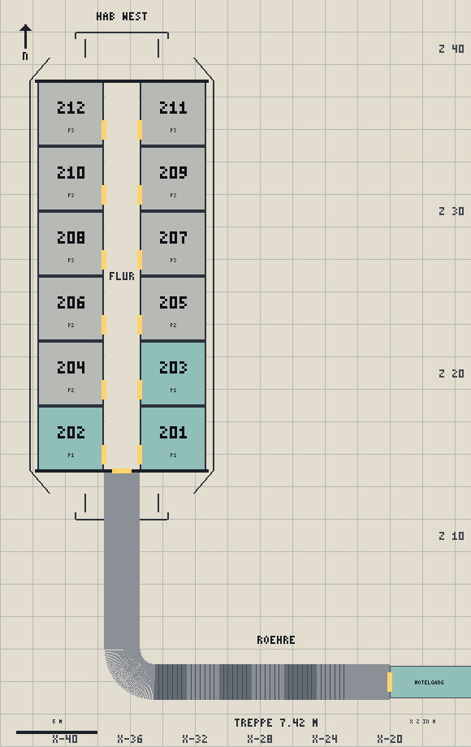

# Wohnmodul Hab_West – begehbarer Innenausbau (P53)

Status: Entwurf der Pipeline, von Max zum Bau freigegeben 06.11.; Einbau durch das Team

Ein Wohnmodul der Station (Hab_West, SM_Ext_HabModule) wird begehbar: Deck, Flur, 12 Räume, zwei Schotte und eine Druckröhre vom Westende des Motelgangs bis in die Südkappe des Moduls. Alle Maße in Unity-Weltkoordinaten (Meter, Y oben), yaw = Drehung um +Y wie in Unity. Plan: `wohnmodul_plan.png`, alle Teile maschinenlesbar: `wohnmodul_layout.json`.



## Entscheidungen

1. **Nur Hab_West** – Ein Modul reicht für 12 Räume; Hab_West liegt dem Motelgang am nächsten (Röhre rund 29 m statt über die Station), die anderen Module bleiben Kulisse.
2. **Innenausbau im bestehenden Zylinder** – Deck auf Y 7,42 (1 m unter der Achse): unter den 12-Eck-Flächen bleiben 3,0 m lichte Raumhöhe und 3,59 m im Flurgewölbe; die Innenhülle (Apothem 5,2) liegt 0,4 m innerhalb der Außenhülle, die Raumrückwand ist die Hülle selbst.
3. **12 Räume (8 Bewohner, 2 Reserve, Lager, Technik)** – Sechs 4-m-Scheiben zu beiden Seiten des Flurs füllen die 24 m zwischen den Schotten ohne Rest; ~4,1 × 4 m je Raum, Bett + Spind + Tisch passen ohne neue Möbel.
4. **Röhre mit Treppe statt Rampe** – 7,42 m Höhenunterschied: eine Rampe ≤ 15° bräuchte 28 m Länge, die Treppe (42 Stufen à 0,177 m, 31,7°) schafft es auf 12 m; Podest am Motel, Bogen R 2 m, Einstieg in der Achse durch die Südkappe.
5. **Zimmer 103 unberührt** – Die Röhre beginnt an der Westwand des Motelgangs (X −20, Z 0..2), nicht in Zimmer 103.
6. **WebGL-Budget** – Kit-Module (Boden, Wände, Türwände, Motel-Möbel) mehrfach platziert; neue Teile mit kleinen Atlanten (Summe der neuen Texturpixel unter 3 × 256²), keine Textur je Raum; die Außenteile der Röhre und das Entry nutzen den Atlas von SM_Ext_HabModule (0 neue Texturen außen).

## Räume

X von Flurwand-Mitte bis Innenhülle, Z von Trennwand-Mitte zu Trennwand-Mitte (lichte Breite 0,1 m weniger je Wand).

| Raum | X von..bis | Z von..bis | Höhe | Leuchtfarbe | Prio |
|---|---|---|---|---|---|
| Flur | −37,6..−35,4 | 14..38 | 3,59 (Gewölbe) | Grün (Motel, GREEN) | P1 |
| 201 Holly | −35,4..−31,3 | 14..18 | 3 | Grün (Motel, GREEN) | P1 |
| 202 Barkeeper | −41,7..−37,6 | 14..18 | 3 | Grün (Motel, GREEN) | P1 |
| 203 Dealer | −35,4..−31,3 | 18..22 | 3 | Grün (Motel, GREEN) | P1 |
| 204 Wache A | −41,7..−37,6 | 18..22 | 3 | Grün (Motel, GREEN) | P2 |
| 205 Wache B | −35,4..−31,3 | 22..26 | 3 | Grün (Motel, GREEN) | P2 |
| 206 Bewohner (frei) | −41,7..−37,6 | 22..26 | 3 | Grün (Motel, GREEN) | P2 |
| 207 Bewohner (frei) | −35,4..−31,3 | 26..30 | 3 | Grün (Motel, GREEN) | P3 |
| 208 Bewohner (frei) | −41,7..−37,6 | 26..30 | 3 | Grün (Motel, GREEN) | P3 |
| 209 Reserve / Gäste | −35,4..−31,3 | 30..34 | 3 | Grün (Motel, GREEN) | P3 |
| 210 Reserve / Gäste | −41,7..−37,6 | 30..34 | 3 | Grün (Motel, GREEN) | P3 |
| 211 Lager | −35,4..−31,3 | 34..38 | 3 | Grün (Motel, GREEN) | P3 |
| 212 Technik | −41,7..−37,6 | 34..38 | 3 | Grün (Motel, GREEN) | P3 |
| Röhre | −20..−36,5 | 1..14 | 2,45 (Boden 2,19 breit) | Grün (Scheitelstreifen) | P1 |

## Öffnungen

| Öffnung | Wand | Position (Mitte) | Breite × Höhe |
|---|---|---|---|
| Door_HabTube (Druckschott) | Motelgang Westwand, X −19,9 (Wandmitte) | (−19,9; 1,1; 1) | 1,2 × 2,2 m |
| Röhrendurchbruch Motel-Außenhülle | Hüllplatte X −20,15 … −20,35 (Builder) | (−20,25; 1; 1) | Röhrenquerschnitt 2,9 × 2,45 m (12-Eck, Boden flach) |
| Hab-Einstieg Südkappe | SM_Ext_HabModule_Entry, Kappe Z 11 | (−36,5; 8,42; 11) | 12-Eck Apothem 1,6 m (Ø 3,2 m) |
| Door_HabSouth | Schott Süd, Z 14 | (−36,5; 8,52; 14) | 1,2 × 2,2 m |
| Door_Hab201 | Flurwand Ost, X −35,4 | (−35,4; 8,52; 15) | 1,2 × 2,2 m |
| Door_Hab202 | Flurwand West, X −37,6 | (−37,6; 8,52; 15) | 1,2 × 2,2 m |
| Door_Hab203 | Flurwand Ost, X −35,4 | (−35,4; 8,52; 19) | 1,2 × 2,2 m |
| Door_Hab204 | Flurwand West, X −37,6 | (−37,6; 8,52; 19) | 1,2 × 2,2 m |
| Door_Hab205 | Flurwand Ost, X −35,4 | (−35,4; 8,52; 23) | 1,2 × 2,2 m |
| Door_Hab206 | Flurwand West, X −37,6 | (−37,6; 8,52; 23) | 1,2 × 2,2 m |
| Door_Hab207 | Flurwand Ost, X −35,4 | (−35,4; 8,52; 27) | 1,2 × 2,2 m |
| Door_Hab208 | Flurwand West, X −37,6 | (−37,6; 8,52; 27) | 1,2 × 2,2 m |
| Door_Hab209 | Flurwand Ost, X −35,4 | (−35,4; 8,52; 31) | 1,2 × 2,2 m |
| Door_Hab210 | Flurwand West, X −37,6 | (−37,6; 8,52; 31) | 1,2 × 2,2 m |
| Door_Hab211 | Flurwand Ost, X −35,4 | (−35,4; 8,52; 35) | 1,2 × 2,2 m |
| Door_Hab212 | Flurwand West, X −37,6 | (−37,6; 8,52; 35) | 1,2 × 2,2 m |

## Türen (Vorschlag für StationGrayboxBuilder)

```csharp
new DoorSpec("Door_HabTube", true, -20f, 1f, 1.2f, DoorAccess.Public),  // Boden Y 0
new DoorSpec("Door_HabSouth", false, 14f, -36.5f, 1.2f, DoorAccess.Public),  // Boden Y 7.42
new DoorSpec("Door_Hab201", true, -35.4f, 15f, 1.2f, DoorAccess.Locked),  // Boden Y 7.42
new DoorSpec("Door_Hab202", true, -37.6f, 15f, 1.2f, DoorAccess.Locked),  // Boden Y 7.42
new DoorSpec("Door_Hab203", true, -35.4f, 19f, 1.2f, DoorAccess.Locked),  // Boden Y 7.42
new DoorSpec("Door_Hab204", true, -37.6f, 19f, 1.2f, DoorAccess.Locked),  // Boden Y 7.42
new DoorSpec("Door_Hab205", true, -35.4f, 23f, 1.2f, DoorAccess.Locked),  // Boden Y 7.42
new DoorSpec("Door_Hab206", true, -37.6f, 23f, 1.2f, DoorAccess.Locked),  // Boden Y 7.42
new DoorSpec("Door_Hab207", true, -35.4f, 27f, 1.2f, DoorAccess.Locked),  // Boden Y 7.42
new DoorSpec("Door_Hab208", true, -37.6f, 27f, 1.2f, DoorAccess.Locked),  // Boden Y 7.42
new DoorSpec("Door_Hab209", true, -35.4f, 31f, 1.2f, DoorAccess.Public),  // Boden Y 7.42
new DoorSpec("Door_Hab210", true, -37.6f, 31f, 1.2f, DoorAccess.Public),  // Boden Y 7.42
new DoorSpec("Door_Hab211", true, -35.4f, 35f, 1.2f, DoorAccess.Public),  // Boden Y 7.42
new DoorSpec("Door_Hab212", true, -37.6f, 35f, 1.2f, DoorAccess.Locked),  // Boden Y 7.42
```

## Teile und Platzierung

Position = Pivot des FBX (Kit-Wände: Mitte der Wandlinie auf dem Boden, Front lokal −Z; Röhrenteile: Bodenmitte am Röhrenanfang, lokal +Z entlang der Röhre).

| # | Teil | Position (X; Y; Z) | yaw | Gruppe | Hinweis |
|---|---|---|---|---|---|
| 1 | SM_Station_Wall_Door_2x3_Narrow | (−19,9; 0; 1) | −90 | Motelgang | setzt der Builder selbst über DoorSpec Door_HabTube (BuildWallVisual, X0 + 0,1); hier nur zur Kontrolle |
| 2 | SM_Station_HabTube_Frame | (−20; 0; 1) | −90 | Röhre | Druckrahmen + Podest 2,5 m |
| 3 | SM_Ext_HabTube_Flange | (−20; 0; 1) | −90 | Röhre außen | Flansch an der Motel-Hülle |
| 4 | SM_Station_HabTube_Stair_2m | (−22,5; 0; 1) | −90 | Röhre | Treppe 1/6 |
| 5 | SM_Ext_HabTube_Stair_2m | (−22,5; 0; 1) | −90 | Röhre außen | Treppe 1/6 |
| 6 | SM_Station_HabTube_Stair_2m | (−24,5; 1,24; 1) | −90 | Röhre | Treppe 2/6 |
| 7 | SM_Ext_HabTube_Stair_2m | (−24,5; 1,24; 1) | −90 | Röhre außen | Treppe 2/6 |
| 8 | SM_Station_HabTube_Stair_2m | (−26,5; 2,47; 1) | −90 | Röhre | Treppe 3/6 |
| 9 | SM_Ext_HabTube_Stair_2m | (−26,5; 2,47; 1) | −90 | Röhre außen | Treppe 3/6 |
| 10 | SM_Station_HabTube_Stair_2m | (−28,5; 3,71; 1) | −90 | Röhre | Treppe 4/6 |
| 11 | SM_Ext_HabTube_Stair_2m | (−28,5; 3,71; 1) | −90 | Röhre außen | Treppe 4/6 |
| 12 | SM_Station_HabTube_Stair_2m | (−30,5; 4,95; 1) | −90 | Röhre | Treppe 5/6 |
| 13 | SM_Ext_HabTube_Stair_2m | (−30,5; 4,95; 1) | −90 | Röhre außen | Treppe 5/6 |
| 14 | SM_Station_HabTube_Stair_2m | (−32,5; 6,18; 1) | −90 | Röhre | Treppe 6/6 |
| 15 | SM_Ext_HabTube_Stair_2m | (−32,5; 6,18; 1) | −90 | Röhre außen | Treppe 6/6 |
| 16 | SM_Station_HabTube_Corner | (−34,5; 7,42; 1) | −90 | Röhre | Bogen R 2 m nach Norden |
| 17 | SM_Ext_HabTube_Corner | (−34,5; 7,42; 1) | −90 | Röhre außen | Bogen |
| 18 | SM_Station_HabTube_Straight_2m | (−36,5; 7,42; 3) | 0 | Röhre | gerade 1/4 |
| 19 | SM_Ext_HabTube_Straight_2m | (−36,5; 7,42; 3) | 0 | Röhre außen | gerade 1/4 |
| 20 | SM_Station_HabTube_Straight_2m | (−36,5; 7,42; 5) | 0 | Röhre | gerade 2/4 |
| 21 | SM_Ext_HabTube_Straight_2m | (−36,5; 7,42; 5) | 0 | Röhre außen | gerade 2/4 |
| 22 | SM_Station_HabTube_Straight_2m | (−36,5; 7,42; 7) | 0 | Röhre | gerade 3/4 |
| 23 | SM_Ext_HabTube_Straight_2m | (−36,5; 7,42; 7) | 0 | Röhre außen | gerade 3/4 |
| 24 | SM_Station_HabTube_Straight_2m | (−36,5; 7,42; 9) | 0 | Röhre | gerade 4/4 |
| 25 | SM_Ext_HabTube_Straight_2m | (−36,5; 7,42; 9) | 0 | Röhre außen | gerade 4/4 |
| 26 | SM_Station_HabTube_Collar | (−36,5; 7,42; 11) | 0 | Röhre | Einstieg durch die Südkappe Z 11..14 |
| 27 | SM_Ext_HabModule_Entry | (−36,5; 8,42; 26) | 0 | Hab außen | ersetzt SM_Ext_HabModule an Hab_West, gleiche Transformation (Südkappe mit Öffnung) |
| 28 | SM_Station_Hab_Bulkhead | (−36,5; 7,42; 14) | 0 | Schott | Süd |
| 29 | SM_Station_Wall_Door_2x3_Narrow | (−36,5; 7,42; 14) | 180 | Schott | Door_HabSouth |
| 30 | SM_Station_Hab_Bulkhead | (−36,5; 7,42; 38) | 0 | Schott | Nord |
| 31 | SM_Station_Wall_2x3_Screen | (−36,5; 7,42; 38) | 0 | Schott | Flurende Nord, Bildschirm zum Flur |
| 92 | SM_Station_Hab_Shell_4m | (−36,5; 7,42; 16) | 0 | Hülle innen | Scheibe 1/6 |
| 93 | SM_Station_Wall_Door_2x3_Narrow | (−35,4; 7,42; 15) | 90 | Flur | Tür 201 |
| 94 | SM_Station_Wall_2x3_Panel | (−35,4; 7,42; 17) | 90 | Flur | Wand 201 |
| 95 | SM_Station_Wall_Door_2x3_Narrow | (−37,6; 7,42; 15) | −90 | Flur | Tür 202 |
| 96 | SM_Station_Wall_2x3 | (−37,6; 7,42; 17) | −90 | Flur | Wand 202 |
| 97 | SM_Station_Hab_LightStrip_2m | (−36,5; 11,01; 15) | 90 | Licht | Flur |
| 98 | SM_Station_Hab_LightStrip_2m | (−36,5; 11,01; 17) | 90 | Licht | Flur |
| 99 | SM_Station_Hab_LightStrip_2m | (−33,5; 10,42; 16) | 0 | Licht | 201 |
| 100 | SM_Motel_Bed | (−32,05; 7,42; 16,9) | 0 | Möbel | 201 |
| 101 | SM_Motel_Locker | (−34,9; 7,42; 17,65) | 0 | Möbel | 201 |
| 102 | SM_Motel_Table | (−31,9; 7,42; 14,4) | 180 | Möbel | 201 |
| 103 | SM_Station_Hab_LightStrip_2m | (−39,5; 10,42; 16) | 0 | Licht | 202 |
| 104 | SM_Motel_Bed | (−40,95; 7,42; 16,9) | 0 | Möbel | 202 |
| 105 | SM_Motel_Locker | (−38,1; 7,42; 17,65) | 0 | Möbel | 202 |
| 106 | SM_Motel_Table | (−41,1; 7,42; 14,4) | 180 | Möbel | 202 |
| 107 | SM_Station_Hab_Shell_4m | (−36,5; 7,42; 20) | 0 | Hülle innen | Scheibe 2/6 |
| 108 | SM_Station_Wall_Door_2x3_Narrow | (−35,4; 7,42; 19) | 90 | Flur | Tür 203 |
| 109 | SM_Station_Wall_2x3 | (−35,4; 7,42; 21) | 90 | Flur | Wand 203 |
| 110 | SM_Station_Wall_Door_2x3_Narrow | (−37,6; 7,42; 19) | −90 | Flur | Tür 204 |
| 111 | SM_Station_Wall_2x3_Padded | (−37,6; 7,42; 21) | −90 | Flur | Wand 204 |
| 112 | SM_Station_Hab_LightStrip_2m | (−36,5; 11,01; 19) | 90 | Licht | Flur |
| 113 | SM_Station_Hab_LightStrip_2m | (−36,5; 11,01; 21) | 90 | Licht | Flur |
| 114 | SM_Station_Wall_2x3 | (−38,7; 7,42; 18) | 0 | Raumtrenner |  |
| 115 | SM_Station_Wall_2x3 | (−40,7; 7,42; 18) | 0 | Raumtrenner |  |
| 116 | SM_Station_Wall_2x3 | (−34,3; 7,42; 18) | 0 | Raumtrenner |  |
| 117 | SM_Station_Wall_2x3 | (−32,3; 7,42; 18) | 0 | Raumtrenner |  |
| 118 | SM_Station_Hab_LightStrip_2m | (−33,5; 10,42; 20) | 0 | Licht | 203 |
| 119 | SM_Motel_Bed | (−32,05; 7,42; 20,9) | 0 | Möbel | 203 |
| 120 | SM_Motel_Locker | (−34,9; 7,42; 21,65) | 0 | Möbel | 203 |
| 121 | SM_Motel_Table | (−31,9; 7,42; 18,4) | 180 | Möbel | 203 |
| 122 | SM_Station_Hab_LightStrip_2m | (−39,5; 10,42; 20) | 0 | Licht | 204 |
| 123 | SM_Motel_Bed | (−40,95; 7,42; 20,9) | 0 | Möbel | 204 |
| 124 | SM_Motel_Locker | (−38,1; 7,42; 21,65) | 0 | Möbel | 204 |
| 125 | SM_Motel_Table | (−41,1; 7,42; 18,4) | 180 | Möbel | 204 |
| 126 | SM_Station_Hab_Shell_4m | (−36,5; 7,42; 24) | 0 | Hülle innen | Scheibe 3/6 |
| 127 | SM_Station_Wall_Door_2x3_Narrow | (−35,4; 7,42; 23) | 90 | Flur | Tür 205 |
| 128 | SM_Station_Wall_2x3_Padded | (−35,4; 7,42; 25) | 90 | Flur | Wand 205 |
| 129 | SM_Station_Wall_Door_2x3_Narrow | (−37,6; 7,42; 23) | −90 | Flur | Tür 206 |
| 130 | SM_Station_Wall_2x3_Panel | (−37,6; 7,42; 25) | −90 | Flur | Wand 206 |
| 131 | SM_Station_Hab_LightStrip_2m | (−36,5; 11,01; 23) | 90 | Licht | Flur |
| 132 | SM_Station_Hab_LightStrip_2m | (−36,5; 11,01; 25) | 90 | Licht | Flur |
| 133 | SM_Station_Wall_2x3 | (−38,7; 7,42; 22) | 0 | Raumtrenner |  |
| 134 | SM_Station_Wall_2x3 | (−40,7; 7,42; 22) | 0 | Raumtrenner |  |
| 135 | SM_Station_Wall_2x3 | (−34,3; 7,42; 22) | 0 | Raumtrenner |  |
| 136 | SM_Station_Wall_2x3 | (−32,3; 7,42; 22) | 0 | Raumtrenner |  |
| 137 | SM_Station_Hab_LightStrip_2m | (−33,5; 10,42; 24) | 0 | Licht | 205 |
| 138 | SM_Motel_Bed | (−32,05; 7,42; 24,9) | 0 | Möbel | 205 |
| 139 | SM_Motel_Locker | (−34,9; 7,42; 25,65) | 0 | Möbel | 205 |
| 140 | SM_Motel_Table | (−31,9; 7,42; 22,4) | 180 | Möbel | 205 |
| 141 | SM_Station_Hab_LightStrip_2m | (−39,5; 10,42; 24) | 0 | Licht | 206 |
| 142 | SM_Motel_Bed | (−40,95; 7,42; 24,9) | 0 | Möbel | 206 |
| 143 | SM_Motel_Locker | (−38,1; 7,42; 25,65) | 0 | Möbel | 206 |
| 144 | SM_Motel_Table | (−41,1; 7,42; 22,4) | 180 | Möbel | 206 |
| 145 | SM_Station_Hab_Shell_4m | (−36,5; 7,42; 28) | 0 | Hülle innen | Scheibe 4/6 |
| 146 | SM_Station_Wall_Door_2x3_Narrow | (−35,4; 7,42; 27) | 90 | Flur | Tür 207 |
| 147 | SM_Station_Wall_2x3_Panel | (−35,4; 7,42; 29) | 90 | Flur | Wand 207 |
| 148 | SM_Station_Wall_Door_2x3_Narrow | (−37,6; 7,42; 27) | −90 | Flur | Tür 208 |
| 149 | SM_Station_Wall_2x3 | (−37,6; 7,42; 29) | −90 | Flur | Wand 208 |
| 150 | SM_Station_Hab_LightStrip_2m | (−36,5; 11,01; 27) | 90 | Licht | Flur |
| 151 | SM_Station_Hab_LightStrip_2m | (−36,5; 11,01; 29) | 90 | Licht | Flur |
| 152 | SM_Station_Wall_2x3 | (−38,7; 7,42; 26) | 0 | Raumtrenner |  |
| 153 | SM_Station_Wall_2x3 | (−40,7; 7,42; 26) | 0 | Raumtrenner |  |
| 154 | SM_Station_Wall_2x3 | (−34,3; 7,42; 26) | 0 | Raumtrenner |  |
| 155 | SM_Station_Wall_2x3 | (−32,3; 7,42; 26) | 0 | Raumtrenner |  |
| 156 | SM_Station_Hab_LightStrip_2m | (−33,5; 10,42; 28) | 0 | Licht | 207 |
| 157 | SM_Motel_Bed | (−32,05; 7,42; 28,9) | 0 | Möbel | 207 |
| 158 | SM_Motel_Locker | (−34,9; 7,42; 29,65) | 0 | Möbel | 207 |
| 159 | SM_Motel_Table | (−31,9; 7,42; 26,4) | 180 | Möbel | 207 |
| 160 | SM_Station_Hab_LightStrip_2m | (−39,5; 10,42; 28) | 0 | Licht | 208 |
| 161 | SM_Motel_Bed | (−40,95; 7,42; 28,9) | 0 | Möbel | 208 |
| 162 | SM_Motel_Locker | (−38,1; 7,42; 29,65) | 0 | Möbel | 208 |
| 163 | SM_Motel_Table | (−41,1; 7,42; 26,4) | 180 | Möbel | 208 |
| 164 | SM_Station_Hab_Shell_4m | (−36,5; 7,42; 32) | 0 | Hülle innen | Scheibe 5/6 |
| 165 | SM_Station_Wall_Door_2x3_Narrow | (−35,4; 7,42; 31) | 90 | Flur | Tür 209 |
| 166 | SM_Station_Wall_2x3 | (−35,4; 7,42; 33) | 90 | Flur | Wand 209 |
| 167 | SM_Station_Wall_Door_2x3_Narrow | (−37,6; 7,42; 31) | −90 | Flur | Tür 210 |
| 168 | SM_Station_Wall_2x3_Padded | (−37,6; 7,42; 33) | −90 | Flur | Wand 210 |
| 169 | SM_Station_Hab_LightStrip_2m | (−36,5; 11,01; 31) | 90 | Licht | Flur |
| 170 | SM_Station_Hab_LightStrip_2m | (−36,5; 11,01; 33) | 90 | Licht | Flur |
| 171 | SM_Station_Wall_2x3 | (−38,7; 7,42; 30) | 0 | Raumtrenner |  |
| 172 | SM_Station_Wall_2x3 | (−40,7; 7,42; 30) | 0 | Raumtrenner |  |
| 173 | SM_Station_Wall_2x3 | (−34,3; 7,42; 30) | 0 | Raumtrenner |  |
| 174 | SM_Station_Wall_2x3 | (−32,3; 7,42; 30) | 0 | Raumtrenner |  |
| 175 | SM_Station_Hab_LightStrip_2m | (−33,5; 10,42; 32) | 0 | Licht | 209 |
| 176 | SM_Motel_Bed | (−32,05; 7,42; 32,9) | 0 | Möbel | 209 |
| 177 | SM_Motel_Locker | (−34,9; 7,42; 33,65) | 0 | Möbel | 209 |
| 178 | SM_Station_Hab_LightStrip_2m | (−39,5; 10,42; 32) | 0 | Licht | 210 |
| 179 | SM_Motel_Bed | (−40,95; 7,42; 32,9) | 0 | Möbel | 210 |
| 180 | SM_Motel_Locker | (−38,1; 7,42; 33,65) | 0 | Möbel | 210 |
| 181 | SM_Station_Hab_Shell_4m | (−36,5; 7,42; 36) | 0 | Hülle innen | Scheibe 6/6 |
| 182 | SM_Station_Wall_Door_2x3_Narrow | (−35,4; 7,42; 35) | 90 | Flur | Tür 211 |
| 183 | SM_Station_Wall_2x3_Padded | (−35,4; 7,42; 37) | 90 | Flur | Wand 211 |
| 184 | SM_Station_Wall_Door_2x3_Narrow | (−37,6; 7,42; 35) | −90 | Flur | Tür 212 |
| 185 | SM_Station_Wall_2x3_Panel | (−37,6; 7,42; 37) | −90 | Flur | Wand 212 |
| 186 | SM_Station_Hab_LightStrip_2m | (−36,5; 11,01; 35) | 90 | Licht | Flur |
| 187 | SM_Station_Hab_LightStrip_2m | (−36,5; 11,01; 37) | 90 | Licht | Flur |
| 188 | SM_Station_Wall_2x3 | (−38,7; 7,42; 34) | 0 | Raumtrenner |  |
| 189 | SM_Station_Wall_2x3 | (−40,7; 7,42; 34) | 0 | Raumtrenner |  |
| 190 | SM_Station_Wall_2x3 | (−34,3; 7,42; 34) | 0 | Raumtrenner |  |
| 191 | SM_Station_Wall_2x3 | (−32,3; 7,42; 34) | 0 | Raumtrenner |  |
| 192 | SM_Station_Hab_LightStrip_2m | (−33,5; 10,42; 36) | 0 | Licht | 211 |
| 193 | SM_Motel_Locker | (−31,85; 7,42; 34,65) | 90 | Möbel | 211 Lager |
| 194 | SM_Motel_Locker | (−31,85; 7,42; 35,35) | 90 | Möbel | 211 Lager |
| 195 | SM_Motel_Locker | (−31,85; 7,42; 36,05) | 90 | Möbel | 211 Lager |
| 196 | SM_Station_Hab_LightStrip_2m | (−39,5; 10,42; 36) | 0 | Licht | 212 |
| – | SM_Station_Floor_2x2 × 60 | X −40,5, −38,5, −36,5, −34,5, −32,5 × Z 15 … 37 (Schritt 2); Y 7,32 | 0 | Deck | Oberkante Y 7,42 |

## Budget

| Teil | Dreiecke | Anzahl | Summe |
|---|---|---|---|
| SM_Motel_Bed | 482 | 10 | 4820 |
| SM_Station_Wall_2x3 | 118 | 24 | 2832 |
| SM_Station_Wall_Door_2x3_Narrow | 160 | 14 | 2240 |
| SM_Station_Wall_2x3_Padded | 504 | 4 | 2016 |
| SM_Station_Wall_2x3_Panel | 316 | 4 | 1264 |
| SM_Motel_Table | 144 | 8 | 1152 |
| SM_Motel_Locker | 84 | 13 | 1092 |
| SM_Ext_HabModule_Entry (neu) | 838 | 1 | 838 |
| SM_Station_HabTube_Stair_2m (neu) | 128 | 6 | 768 |
| SM_Station_Floor_2x2 | 12 | 60 | 720 |
| SM_Station_Hab_Shell_4m (neu) | 76 | 6 | 456 |
| SM_Station_HabTube_Straight_2m (neu) | 88 | 4 | 352 |
| SM_Station_Hab_LightStrip_2m (neu) | 10 | 24 | 240 |
| SM_Station_Wall_2x3_Screen | 200 | 1 | 200 |
| SM_Ext_HabTube_Corner (neu) | 144 | 1 | 144 |
| SM_Ext_HabTube_Stair_2m (neu) | 24 | 6 | 144 |
| SM_Station_HabTube_Collar (neu) | 134 | 1 | 134 |
| SM_Station_HabTube_Corner (neu) | 132 | 1 | 132 |
| SM_Station_HabTube_Frame (neu) | 130 | 1 | 130 |
| SM_Station_Hab_Bulkhead (neu) | 54 | 2 | 108 |
| SM_Ext_HabTube_Straight_2m (neu) | 24 | 4 | 96 |
| SM_Ext_HabTube_Flange (neu) | 72 | 1 | 72 |

Innenausbau + Röhre: 19950 Dreiecke (neue Teile 3614, Kit-Module 16336); das Entry ersetzt das Modul (Dreiecke nicht doppelt).

## To-dos für den Builder

- DoorSpec um eine Boden-Höhe erweitern (Y 0 ist fest verdrahtet): alle Hab-Türen stehen auf Y 7,42.
- DoorSpec Door_HabTube (onXLine, Linie −20, Mitte Z 1, Breite 1,2) ergänzen: der Builder setzt dann selbst SM_Station_Wall_Door_2x3_Narrow (X −19,9, yaw −90) statt des Wandmoduls; in der Motel-Außenhüllplatte die Röhrenöffnung (X −20,15 … −20,35, Apothem 1,6 um Y 1, Z 1) freilassen.
- SM_Ext_HabModule an Hab_West durch SM_Ext_HabModule_Entry ersetzen (gleiche Transformation); bei ihm und den vier SM_Ext_HabTube_* (Flange, Straight_2m, Stair_2m, Corner) den Slot Hull auf M_Ext_HabModule umhängen: sie nutzen die Texturen des Moduls (T_Ext_HabModule_*), der DeliveryIntegrator meldet den Slot als nicht zugeordnet.
- Alle Teile aus wohnmodul_layout.json platzieren (Position, yaw), Collider: Röhre, Treppen und Deck begehbar (MeshCollider oder Boxen je Stufe), Wände/Hülle als Grenzen; NavMesh neu backen.
- Licht: Leuchtstreifen sind Emission (grün); Lightmaps bzw. Light Probes im Wohnmodul neu backen.
- Außen: prüfen, dass die Röhre (X −20 … −36,5, Z 1 … 11) keine anderen Außenteile (Truss, Tanks) schneidet.
- STATION.md um den Abschnitt Wohnmodul ergänzen (Textvorschlag im PR).
